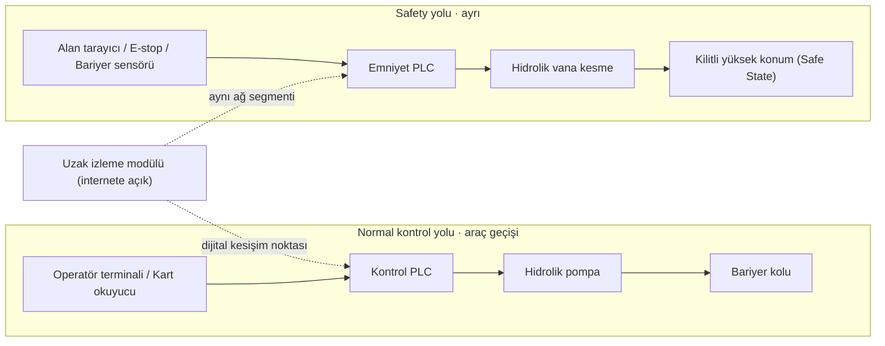

# Safety 4.0 Bootcamp — RB-HRB Hidrolik Yol Bloklayıcı

**Yazılım Mühendisliğinde Güncel Konular** dersi kapsamında yürütülen Safety 4.0 Bootcamp (INSPECCO × Kriptarium)
çalışmalarını içerir. Bootcamp'in yedi laboratuvarının tamamı tek bir gerçek makine üzerinde işlendi: Sakarya Makina
İmalatçıları Birliği (SAMİB) üyesi **Arma Kontrol**'ün **RB-HRB hidrolik yol bloklayıcısı**. Çalışma, makinenin
fonksiyonel emniyetini (safety), siber güvenliğini (security) ve AB mevzuatına (CRA, Makine Tüzüğü) hazırlığını birlikte
ele alıyor ve bir SWOT analiziyle sonuçlanıyor.

## İçerik

| Dosya | İçerik | Sayfa |
|---|---|---|
| [RB-HRB_Lab1-5_Foyleri_v3-3.pdf](RB-HRB_Lab1-5_Foyleri_v3-3.pdf) | Lab 1–5 föyleri: emniyet mimarisi, IEC 62443 bölgelendirme, tehdit ve risk, güvenli uzak erişim, SBOM / CVE / yama | 10 |
| [RB-HRB_Lab6-7_Foyleri.pdf](RB-HRB_Lab6-7_Foyleri.pdf) | Lab 6–7 föyleri: CRA olay müdahale simülasyonu, yapay zekâ güvenliği | 2 |
| [RB-HRB_SWOT_Analizi.pdf](RB-HRB_SWOT_Analizi.pdf) | Makinenin Safety 4.0 odaklı SWOT analizi, TOWS stratejileri, 90 günlük yol haritası | 12 |

## Makine: RB-HRB hidrolik yol bloklayıcı

Hidrolik piston, araç geçişini kontrol eden bariyer kolunu yukarı/aşağı hareket ettirir. Sistemin bileşenleri: hidrolik
piston, yükselen bariyer kolu, alan tarayıcı sensörü, araç algılama döngüsü (loop dedektör), emniyet PLC'si, kontrol
ünitesi ve internete açık bir uzak izleme modülü.

Makinede iki ayrı kontrol yolu var. Normal yol araç geçişini yönetir; safety yolu ise tehlike anında makineyi güvenli
duruma alır. İki yolun dijital olarak kesiştiği nokta, siber-emniyet riskinin doğduğu yerdir:

## Laboratuvarlar

| Lab | Konu | Çıktı | Evidence Pack | Föydeki ana kararlar |
|---|---|---|---|---|
| 1 | Safety Architecture | Safety Function Map | EP 03 | Emniyet fonksiyonu: tehlike algılanınca hidrolik vanayı kesmek; güvenli durum: bariyer kolu yukarıda kilitli; hedef PLr d / SIL 2 |
| 2 | IEC 62443 Mini Workshop | Zone / Conduit Diagram | EP 05 | Dört bölge (saha, kontrol, yönetim/uzak erişim, dış ağ); üç geçiş: firewall, tek yönlü veri diyotu, DMZ + VPN; uzak erişimde jump server, MFA, kişisel hesap, oturum kaydı, varsayılan kapalı |
| 3 | Threat & Risk + Risk Matrix | Risk Register | EP 04 | L × S × E ile üç senaryo: S1 uzak saldırgan, modül üzerinden (Kritik, 18); S2 kilitsiz USB (Yüksek, 12); S3 bina ağından HMI (Orta, 6; S=3 kuralıyla öne alındı) |
| 4 | Secure Remote Access | Secure Architecture | EP 02 + EP 06 | Mevcut → hedef mimari; emniyet zincirinin ağ bağlantısından bağımsız çalışması gereksinimi |
| 5 | SBOM / CVE / Patch | Vulnerability Decision | EP 09 · 10 · 11 ¹ | 6 bileşenli SBOM; en riskli bileşenler OpenVPN 2.4.5 ve Windows CE 6.0; yama karar matrisi ve telafi edici kontroller |
| 6 | CRA Incident Simulation | Incident Workflow | EP 13 | Servis hesabına yetkisiz erişim senaryosu; ilk 15 dk → 2 saat → CRA 24 s / 72 s / 14 gün akışı; “önce emniyet, hemen sonra kanıt” |
| 7 | AI Safety Challenge | AI Fail-Safe Decision | EP 03 + EP 15 | İnsan/araç ayıran YZ sınıflandırıcısı yalnızca öneri verir; emniyet YZ'nin dışında kalır (Prediction ≠ Safety); güven eşiği altında fallback |

¹ Lab 5 föyünde “EP 07” yazıyor; kursun Evidence Pack listesinde SBOM, zafiyet ve yama kayıtları 09, 10 ve 11
numaralı başlıklardır (SWOT, Ek A · A16).

## SWOT analizi

[RB-HRB_SWOT_Analizi.pdf](RB-HRB_SWOT_Analizi.pdf), Lab 1–5 föylerini kanıt olarak kullanan, Safety 4.0 odaklı bir
analizdir:

- **Yöntem:** Her madde föydeki bir soruya ya da kaynaklı bir dış olguya bağlı. Puan = Etki (1–3) × Olasılık (1–3).
  ⚠ işareti insana zarar potansiyelini gösterir ve kursun S=3 kuralı gereği puandan bağımsız olarak öncelikli kalır.
  Her güçlü yön için kanıt olgunluğu (Beyan → Doğrulanmış) belirtilir.
- **Kapsam:** 47 madde (9 güçlü yön, 16 zayıf yön, 9 fırsat, 13 tehdit), 8 TOWS stratejisi, 16 adımlık 90 günlük yol
  haritası, Evidence Pack kanıt durumu.
- **Sonuç:** Stratejik duruş **WT (savunma)**; iç eksen −1,83, dış eksen −0,64. Önce saldırı yüzeyi daraltılmalı ve
  emniyet bağımsızlığı kanıtlanmalı, ardından mevzuat kaynaklı fırsatlara yönelinmeli.
- **Öne çıkan bulgular:**
  - En kritik zincir: internete açık uzak izleme modülü + paylaşılan `admin/1234` hesabı + modülün emniyet PLC'si ile
    aynı ağ segmentinde olması.
  - En değerli güç: ayrık, kablolu emniyet yolu ve SIL 2 emniyet PLC'si; ancak bunlar henüz test kaydıyla kanıtlanmış
    değil.
  - Tasarım düzeyinde çatışma: “yukarıda kilitli” güvenli durumu bir güvenlik hedefi; emniyet açısından algılama
    varken bariyerin yükselmesi tehlikenin kendisi.
  - Mevzuat takvimi: CRA bildirim yükümlülüğü 11 Eylül 2026'dan beri yürürlükte; Makine Tüzüğü 20 Ocak 2027'de
    uygulanmaya başlıyor.
- **Ekler:** Föylerde bulunan 18 tutarsızlığın denetimi (Ek A) ve 27 kaynaklık kaynakça (Ek B).

## Çerçeve ve standartlar

- **ISO 12100 / ISO 13849 / IEC 62061 / IEC 61508** — makine risk değerlendirmesi ve emniyet kontrol sistemlerinin
  güvenilirliği (PLr / SIL)
- **IEC 62443** — endüstriyel otomasyon siber güvenliği; bölge (zone) ve geçiş (conduit) mantığı
- **Siber Dayanıklılık Yasası (AB) 2024/2847 (CRA)** — SBOM, zafiyet yönetimi ve 24 s / 72 s / 14 gün bildirim zinciri
- **Makine Tüzüğü (AB) 2023/1230** — siber güvenliği CE işaretinin ön şartı yapan yeni makine mevzuatı

## Hazırlayan

Fatma Nur Karagöz · Yazılım Mühendisliğinde Güncel Konular · Gündüz 4-B

## Not

Bu çalışma bir eğitim çıktısıdır; resmî denetim, uygunluk değerlendirmesi veya belgelendirme değildir. Föylerdeki ve
SWOT analizindeki teknik zayıflıklar (ör. varsayılan parola, desteği bitmiş yazılımlar) bootcamp senaryosunun
varsayımlarıdır; Arma Kontrol'ün piyasadaki ürünlerine ilişkin doğrulanmış tespitler değildir. Bu çalışmanın üretici
firma ile bir bağı yoktur.
